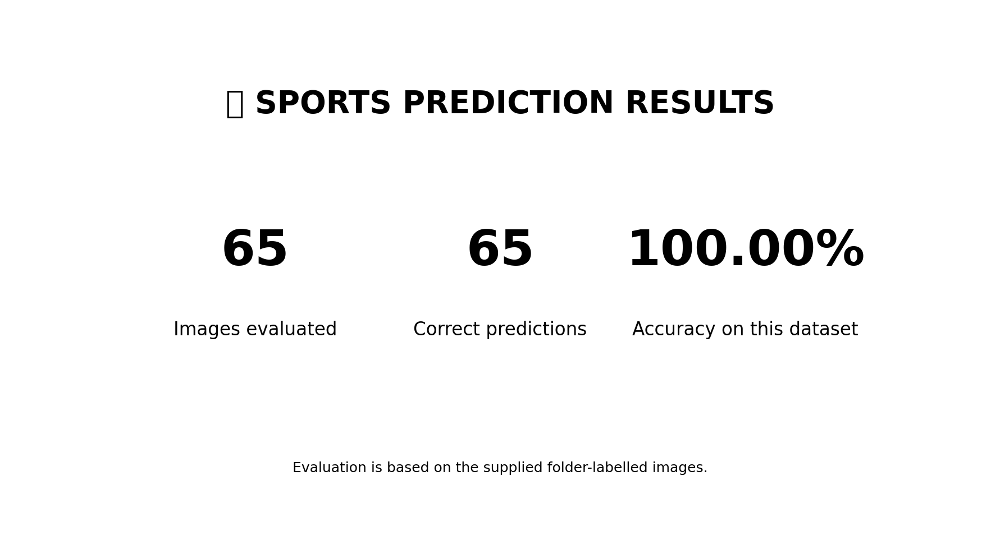
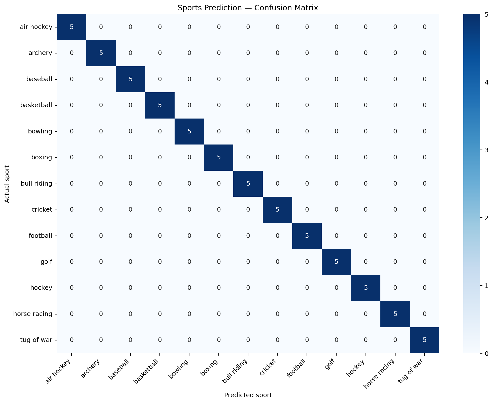
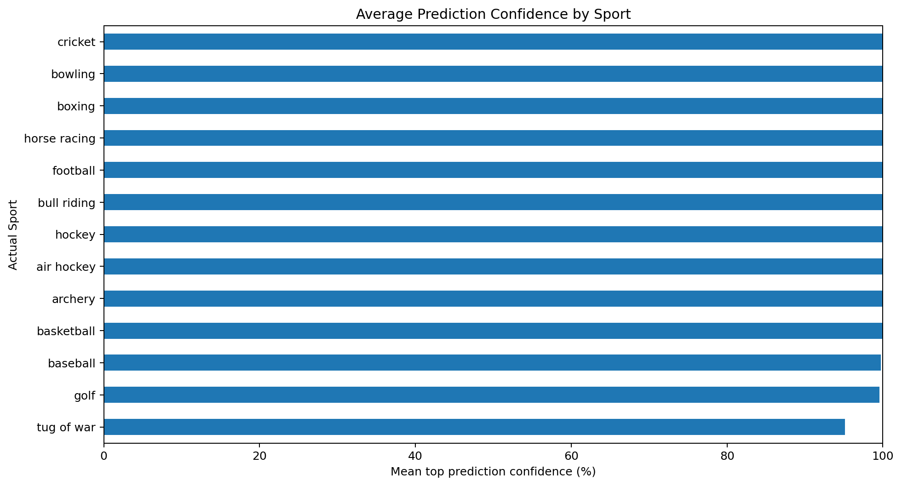

# 🏅 Sports Prediction using Teachable Machine, TensorFlow & Python

Predict the sport shown in an image using a trained **Teachable Machine image-classification model**. This repository includes a Jupyter Notebook for single-image prediction, all-class probability tables, batch prediction across sport folders, evaluation metrics, and CSV exports.


## ✨ Features

- 🖼️ Predict the sport in a single image.
- 📊 Display probabilities for **all 13 sport classes**.
- 📁 Batch-predict images saved in sport-named folders.
- 🎯 Show predicted label, confidence score, and whether it matches the folder label.
- 📈 Calculate accuracy and print a classification report.
- 🧩 Plot a confusion matrix.
- 💾 Export predictions and per-class probability columns to CSV.
- 🔍 Test a new image by changing one file path.

## 🏟️ Supported Classes

The project is configured for these 13 classes:

`air hockey`, `archery`, `baseball`, `basketball`, `bowling`, `boxing`, `bull riding`, `cricket`, `football`, `golf`, `hockey`, `horse racing`, and `tug of war`.

> **Important:** The `class_names` list must be in the exact same order as the output classes used when training the Teachable Machine model. A wrong order can make labels incorrect even if the model runs successfully.

## 📊 Evaluation Snapshot

The supplied prediction CSV contains **65 images**, with **65 correct predictions** and **100.00% accuracy** against the folder names in that CSV.



This is the result on the supplied image set only. It does not guarantee the same accuracy on new, unseen images.

## 🖥️ Screenshots

### Confusion matrix


### Average confidence by sport


These charts are generated from the supplied prediction results. To add screenshots of your actual notebook interface, save them into the `screenshots/` directory and link them here.

## 📂 Project Structure

```text
Sports_Prediction_GitHub/
├── Sports_Prediction_Complete_Project.ipynb
├── sports_predictions.csv
├── requirements.txt
└── screenshots/
    ├── evaluation_summary.png
    ├── confusion_matrix.png
    └── confidence_by_sport.png
```

The trained model (`keras_model.h5`) and image dataset are not included in this bundle. Add your own model file and dataset locally; only upload them to GitHub if you have permission and want them public.

## ⚙️ Installation

### 1. Clone the repository

```bash
git clone https://github.com/YOUR-USERNAME/YOUR-REPOSITORY.git
cd YOUR-REPOSITORY
```

Replace the URL with your GitHub repository URL.

### 2. Create and activate a virtual environment (recommended)

**Windows:**

```bash
python -m venv .venv
.venv\\Scripts\\activate
```

### 3. Install dependencies

```bash
python -m pip install --upgrade pip
pip install -r requirements.txt
```

## 🗂️ Dataset Folder Layout

The notebook expects images inside a folder per class. Example:

```text
D:\\DL\\PR4/
├── keras_model.h5
└── test/
    ├── air hockey/
    │   ├── 1.jpg
    │   ├── 2.jpg
    │   └── ...
    ├── archery/
    ├── baseball/
    ├── basketball/
    ├── bowling/
    ├── boxing/
    ├── bull riding/
    ├── cricket/
    ├── football/
    ├── golf/
    ├── hockey/
    ├── horse racing/
    └── tug of war/
```

Each sport folder should contain the corresponding images. The folder name is used as the actual label during evaluation.

## ▶️ Run the Project

1. Open `Sports_Prediction_Complete_Project.ipynb` in Jupyter Notebook or VS Code.
2. Update `BASE_DIR`, `MODEL_PATH`, and `TEST_FOLDER` in the configuration cell to match your computer.
3. Confirm that `class_names` exactly matches the model's training class order.
4. Run notebook cells from top to bottom.
5. Review the probability table, evaluation output, confusion matrix, and exported CSV files.

The notebook uses a **224 × 224 RGB image** resized and scaled to the usual Teachable Machine range of `[-1, 1]`. If your model was exported with different preprocessing requirements, use the preprocessing settings from that model's export.

## 📄 Output Files

- `sports_predictions.csv` — predictions, confidence, correctness, and probability columns for each class.
- `output/sports_predictions.csv` — generated by the notebook after batch prediction.
- `screenshots/` — evaluation charts for the README.

## 🧰 Tech Stack

- Python
- TensorFlow / `tf_keras`
- NumPy and Pandas
- Pillow
- Matplotlib and Seaborn
- scikit-learn
- Jupyter Notebook

## ⚠️ Notes & Limitations

- Model confidence is not necessarily a calibrated probability.
- Accuracy depends on the quality and diversity of the test images.
- Avoid evaluating only on images used during training; use a separate, representative test set for a more reliable estimate.
- Keep `keras_model.h5` private if it contains data or work you do not intend to publish.

