# Deep Learning Practical Report 6 — Opening the Transformer

**Red & White Skill Education | Deep Learning | PR 6**

This practical explores how Transformer models represent text, calculate attention, and perform common natural-language-processing tasks using Python, NumPy, PyTorch, and Hugging Face Transformers.

> The notebook inspects and uses pretrained models; it does not train or fine-tune them. Run the notebook from top to bottom so that model variables and helper functions are defined before they are used.

## Tasks covered

1. **Introduction, history, pipelines and tokenizer** — explore pretrained sentiment analysis, tokenization, model configuration, and parameter counts.
2. **Self-attention and scaled dot-product attention** — implement attention with NumPy/PyTorch, compare scaling choices, and inspect attention weights.
3. **Multi-head attention, positional encoding and normalization** — examine multiple attention heads, positional information, and LayerNorm.
4. **Encoder architecture and masked self-attention** — inspect encoder behavior and causal masking.
5. **Cross-attention, decoder architecture and inference** — inspect encoder-decoder cross-attention and text generation/translation.
6. **Evaluation, truncation, disadvantages and mini application** — test text tools, sentiment classification, truncation lengths, and runtime behavior.

## Repository structure

```text
DL_PR6_Final/
├── DL_PR6.ipynb
├── README.md
├── requirements.txt
├── VIDEO_SCRIPT.md
└── plots/
    ├── attention_heads.png
    ├── attention_scratch.png
    ├── bidirectional_attention.png
    ├── causal_mask.png
    ├── cross_attention.png
    ├── gpt2_causal_attention.png
    ├── head_entropy.png
    ├── learned_position_similarity.png
    ├── parameter_distribution.png
    ├── positional_encoding.png
    ├── time_vs_length.png
    └── truncation_accuracy.png
```

## Visual results

The figures below are stored in the `plots/` folder. Click a figure heading to view the image in GitHub.

### 1. Scaled dot-product attention from scratch

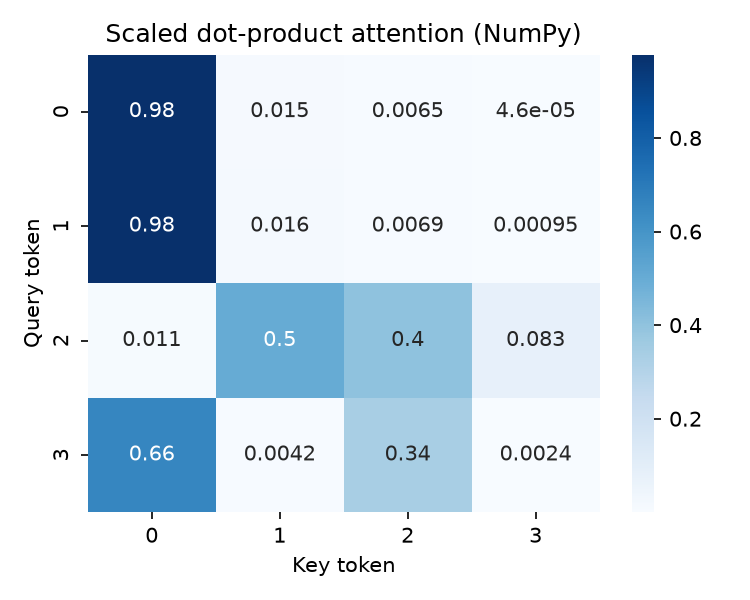

### 2. Attention heads across layers

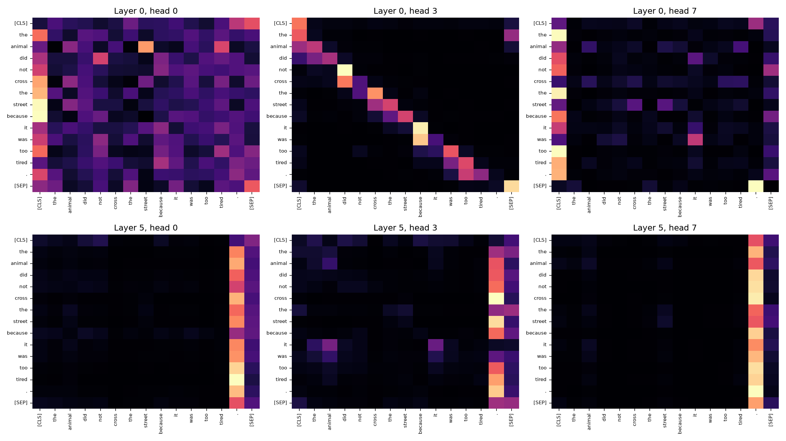

### 3. DistilBERT bidirectional attention

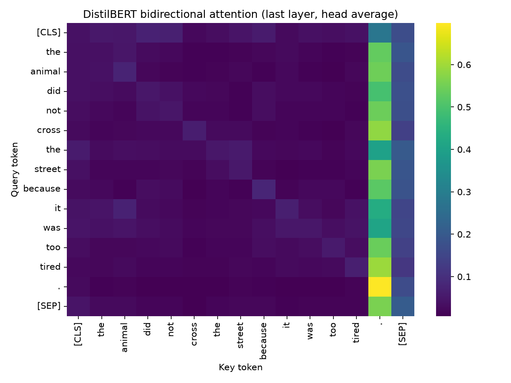

### 4. Causal self-attention mask

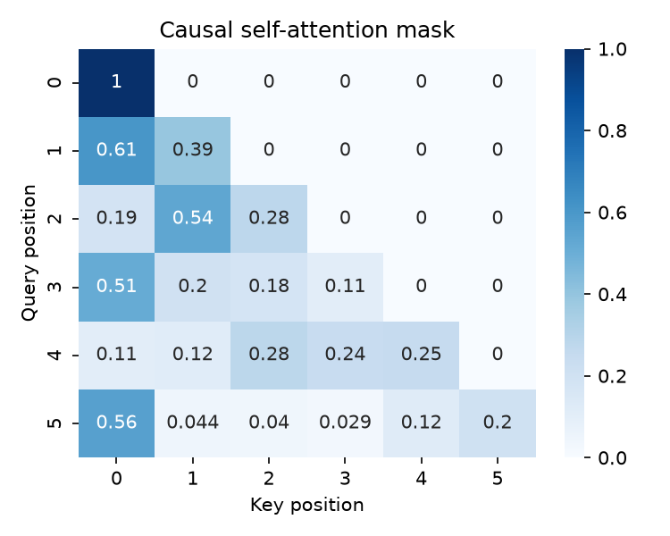

### 5. T5 cross-attention

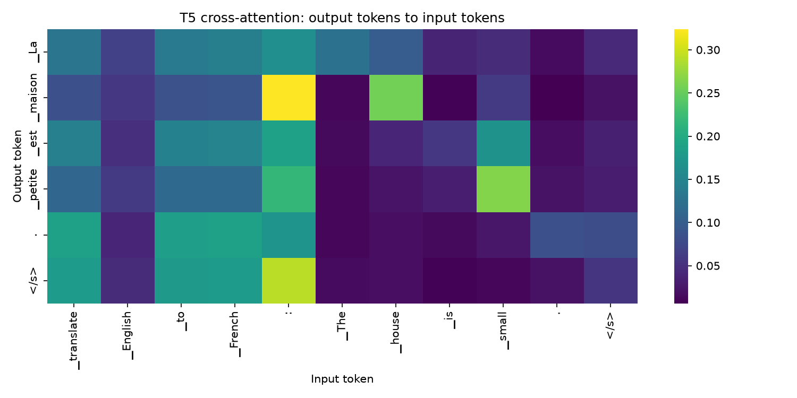

### 6. GPT-2 causal attention

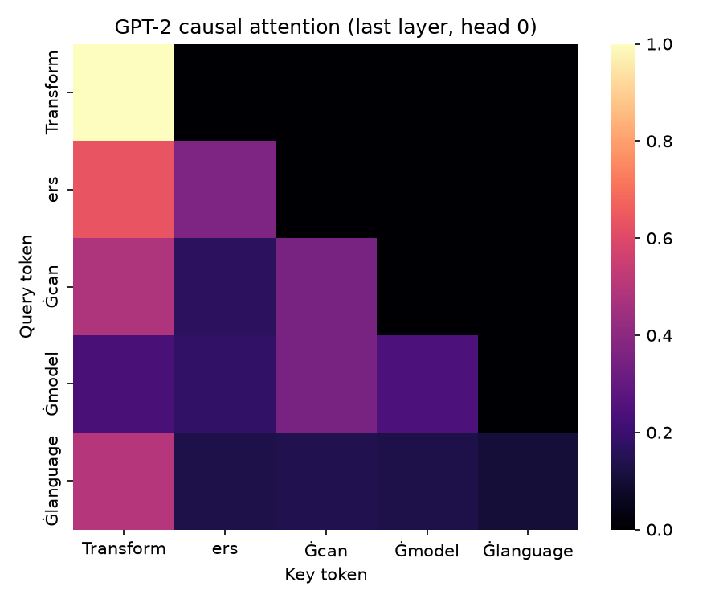

### 7. Attention-head entropy

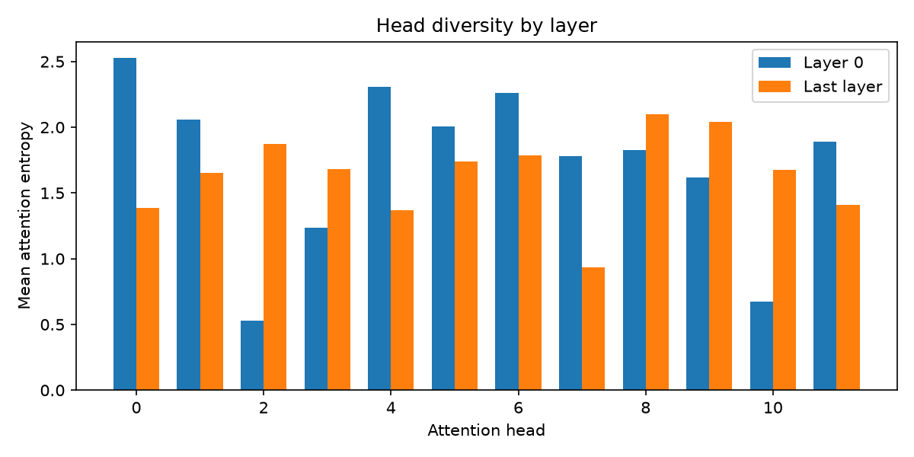

### 8. Learned position embedding similarity

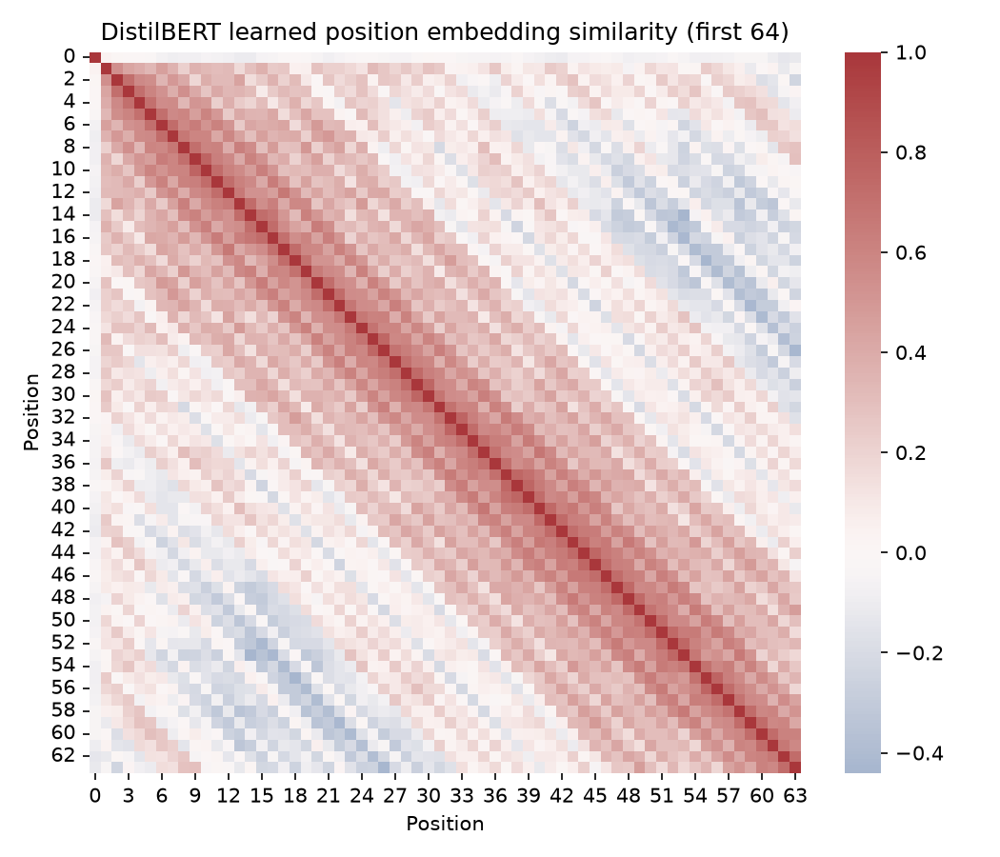

### 9. DistilBERT parameter distribution

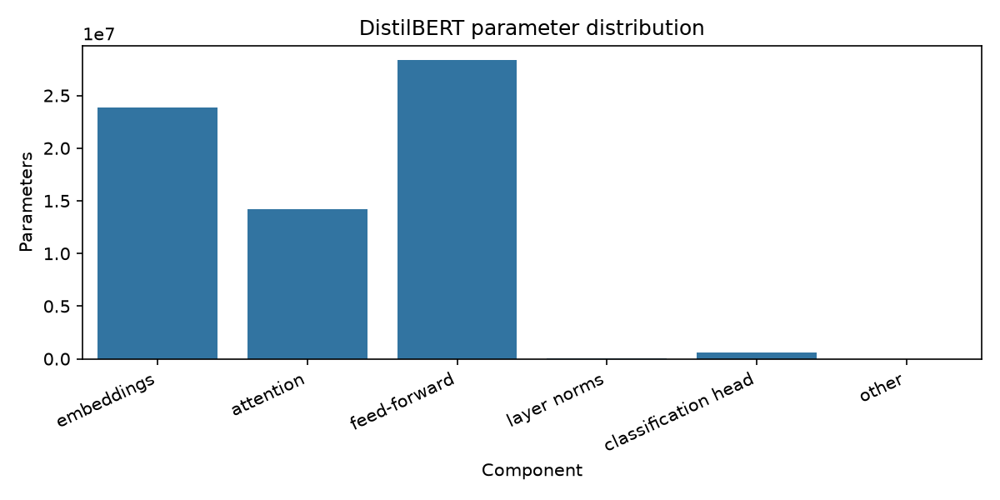

### 10. Sinusoidal positional encoding

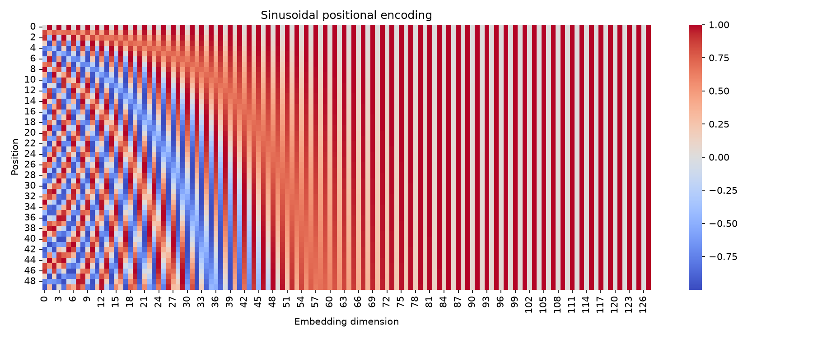

### 11. Forward-pass time versus sequence length

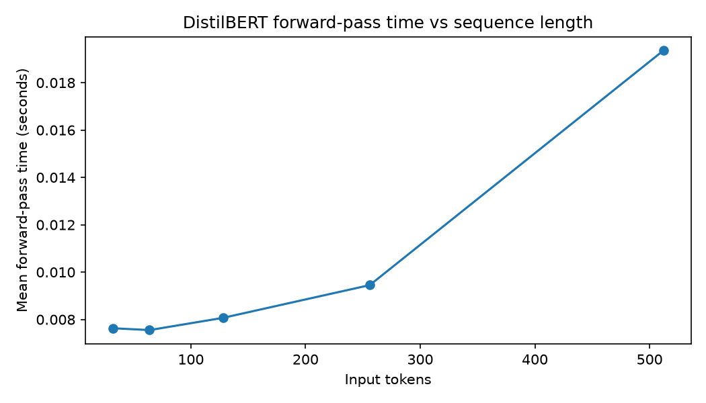

### 12. IMDB sentiment accuracy versus truncation length

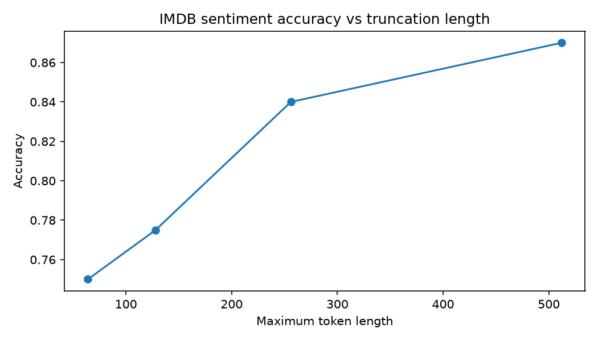

## Setup

Use Python 3.12 if it matches the environment used for this practical. From the project folder, install the listed packages:

```bash
python -m pip install -r requirements.txt
```

Open `DL_PR6.ipynb` in Jupyter Notebook, JupyterLab, or VS Code and run cells in order. The first run may download pretrained model files and the IMDB dataset, so an internet connection is required. Model downloads and inference time depend on your computer and network.

## Troubleshooting notes

- **Variables are not defined:** run the notebook cells in order from the beginning; if a cell fails, fix it and rerun it before running later cells.
- **Tensor `.numpy()` error:** use `tensor.detach().cpu().numpy()` for tensors that may require gradients.
- **Hugging Face pipeline task removed:** recent Transformers versions have removed some legacy pipeline task names. If the notebook's installed version reports that `summarization`, `translation`, or `text2text-generation` is removed, use a compatible Transformers version or call the T5 tokenizer/model directly with `generate()`.
- **IMDB dataset download error:** check internet access and update `datasets`/`huggingface_hub`, then retry. If the dataset repository cannot be resolved, use the official Hugging Face dataset repository ID supported by your installed `datasets` version.
- **Unexpected model loading keys:** some checkpoints can report unused weights when loaded into a different model architecture; check that the checkpoint and model class are intended to match.

## Tools and libraries

- Python
- NumPy and Pandas
- Matplotlib and Seaborn
- PyTorch
- Hugging Face Transformers and Datasets

## Learning outcomes

After completing the practical, a student should be able to explain queries, keys, and values; calculate scaled dot-product attention; describe multi-head attention and positional encodings; distinguish bidirectional encoder attention from causal decoder attention; interpret encoder-decoder cross-attention; and inspect basic inference performance and truncation effects.

## Notes

Figures are saved as static PNGs for viewing in GitHub. Results such as timing and accuracy can vary by machine, package version, and dataset sample. The notebook is the primary source for the full code and outputs.
