# PR5 — Sentiment Analysis with RNN, LSTM and GRU

**Dataset Link:** [Download IMDB Dataset of 50K Movie Reviews from Kaggle](https://www.kaggle.com/datasets/lakshmi25npathi/imdb-dataset-of-50k-movie-reviews)


An end-to-end deep learning project for classifying IMDB movie reviews as **positive** or **negative** using recurrent neural networks. This practical explores text preprocessing, sequence modeling, model training, gradient behavior, evaluation, and custom predictions.

## Contents

- [Project Objectives](#project-objectives)
- [Models](#models)
- [Dataset](#dataset)
- [Project Structure](#project-structure)
- [Installation](#installation)
- [How to Run](#how-to-run)
- [Practical Tasks](#practical-tasks)
- [Results](#results)
- [Visualizations](#visualizations)
- [Important Notes](#important-notes)
- [Technologies](#technologies)

## Project Objectives

- Clean and prepare IMDB review text for deep learning.
- Convert text into token sequences and pad sequences to a consistent length.
- Build an ANN baseline and compare it with SimpleRNN, LSTM, and GRU models.
- Understand recurrent neural networks and Backpropagation Through Time (BPTT).
- Explore gradient clipping and sequence-length effects.
- Evaluate models using accuracy, confusion matrices, ROC curves, and AUC.
- Inspect misclassified reviews and test custom review examples.

## Models

| Model | Purpose |
|---|---|
| ANN baseline | Non-recurrent baseline for comparison |
| SimpleRNN | Basic recurrent neural network |
| LSTM | Recurrent model with memory gates |
| GRU | Gated recurrent model with a simpler gate structure than LSTM |

## Dataset

The notebook expects an IMDB dataset CSV named:

```text
IMDB Dataset.csv
```

It should contain review text and sentiment labels. If your dataset has different column names, update the loading cell in the notebook.

**Note:** The dataset is not bundled here. Place it beside the notebook before running the project. Only redistribute the dataset if its license permits it.

## Project Structure

```text
PR5/
├── pr5.ipynb
├── README.md
├── IMDB Dataset.csv              # add locally; not included
└── plots/
    ├── gradient_clipping.png
    ├── gru_confusion.png
    ├── gru_curves.png
    ├── length_robustness.png
    ├── lstm_confusion.png
    ├── lstm_curves.png
    ├── manual_rnn_heatmap.png
    ├── review_length_by_sentiment.png
    ├── review_length_histogram.png
    ├── roc_curves.png
    ├── simplernn_confusion.png
    └── simplernn_curves.png
```

## Installation

Recommended: Python 3.10 or 3.11 with Jupyter Notebook or JupyterLab.

Install the main dependencies:

```bash
pip install tensorflow numpy pandas matplotlib seaborn scikit-learn jupyter
```

### GPU support

TensorFlow uses a compatible GPU automatically for supported operations. GPU availability depends on your operating system, TensorFlow version, NVIDIA driver, and CUDA setup. For modern TensorFlow versions on Windows, use a supported WSL2/Linux environment and follow the official TensorFlow installation guidance. The notebook can also run on CPU.

Check GPU detection in Python:

```python
import tensorflow as tf
print(tf.config.list_physical_devices("GPU"))
```

## How to Run

1. Clone or download this repository.
2. Put `IMDB Dataset.csv` in the same folder as the notebook.
3. Install the dependencies.
4. Start Jupyter:

   ```bash
   jupyter notebook
   ```

5. Open `pr5.ipynb`.
6. Run the notebook cells in order.
7. Review the generated charts and CSV outputs in the `plots/` folder.

## Practical Tasks

### Task 1 — Load and Prepare Text
- Load the dataset and remove duplicate reviews.
- Clean review text.
- Analyze review lengths.
- Split the data into training and test sets.
- Fit the tokenizer on training text only, then tokenize and pad sequences.

### Task 2 — RNN Basics and ANN Baseline
- Review the intuition behind sequential data.
- Compare ANN and RNN approaches.
- Train a baseline model.

### Task 3 — SimpleRNN
- Build and train a SimpleRNN model.
- Plot training and validation metrics.
- Evaluate predictions using a confusion matrix.

### Task 4 — Backpropagation Through Time (BPTT)
- Explore recurrent sequence processing.
- Investigate sequence-length effects.
- Demonstrate gradient clipping and discuss gradient-related problems.

### Task 5 — LSTM
- Train an LSTM model.
- Plot training and validation loss and accuracy.
- Evaluate predictions with a confusion matrix.

### Task 6 — GRU
- Train a GRU model.
- Plot training and validation loss and accuracy.
- Evaluate predictions with a confusion matrix.
- Compare GRU and LSTM behavior.

### Task 7 — Model Comparison and Predictions
- Compare model metrics.
- Plot ROC curves and AUC values.
- Inspect misclassified reviews.
- Run custom sentiment predictions.

## Results

The ROC plot from the current notebook output reports these AUC values:

| Model | ROC AUC |
|---|---:|
| ANN baseline | 0.915 |
| LSTM | 0.951 |
| GRU | 0.952 |

In this run, GRU has the highest AUC by a small margin, closely followed by LSTM. Results can change with random seeds, preprocessing, train/test split, and training settings. Use the metrics generated by your own notebook run when reporting final results.

## Visualizations

The following figures are included in this repository. GitHub renders them directly from the `plots/` folder.

### 1. IMDB Review Length Distribution

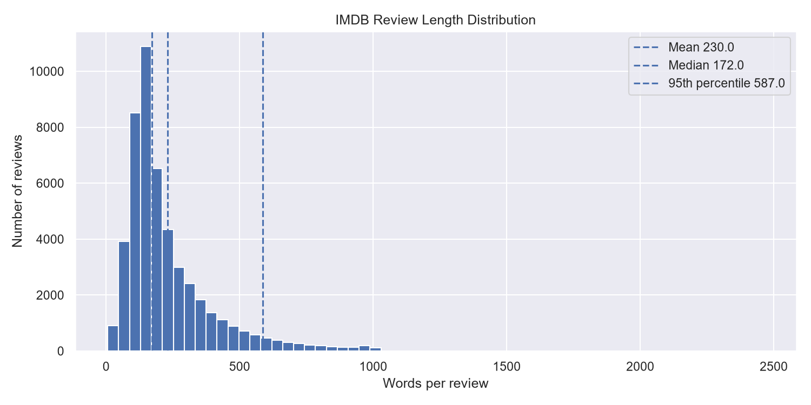

### 2. Review Length by Sentiment

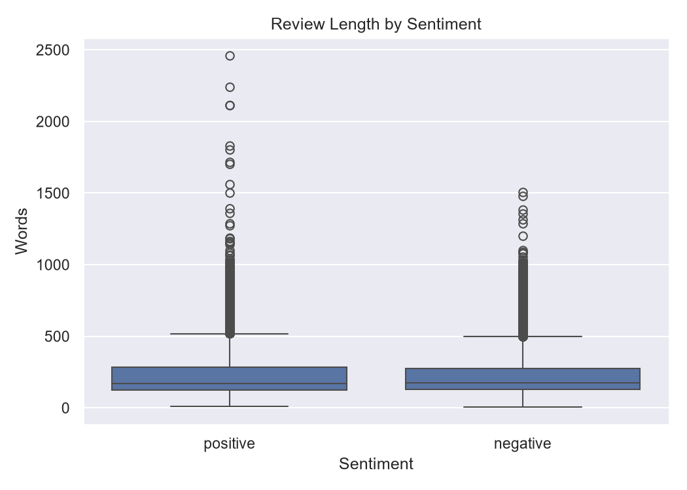

### 3. Manual RNN Hidden States

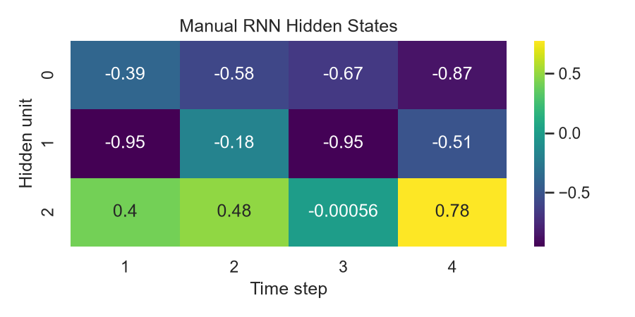

### 4. Gradient Clipping Experiment

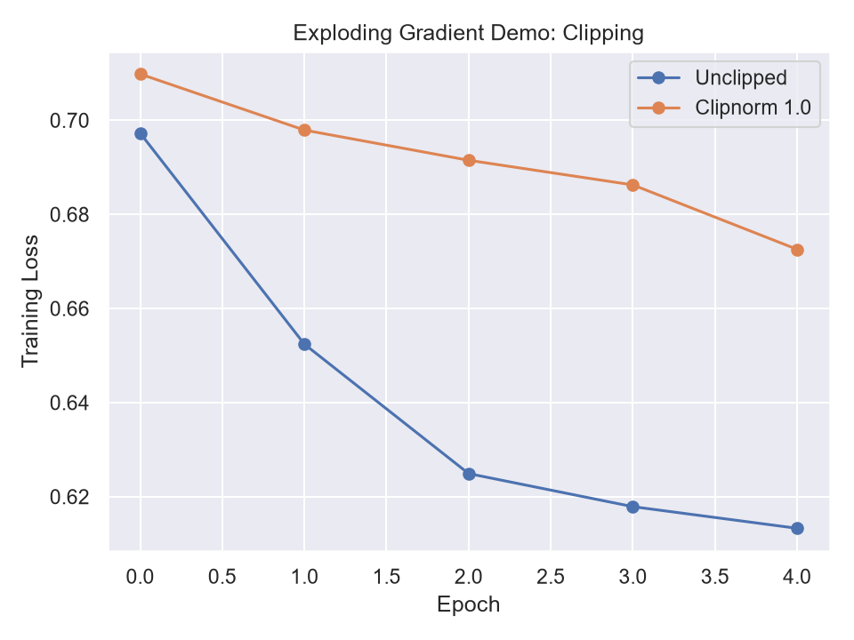

### 5. SimpleRNN Training Curves

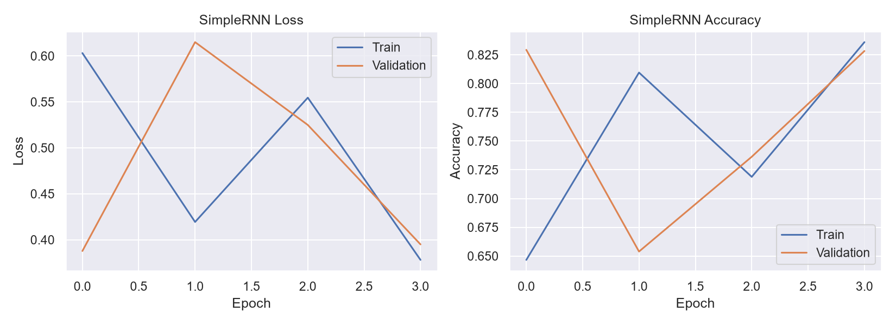

### 6. SimpleRNN Confusion Matrix

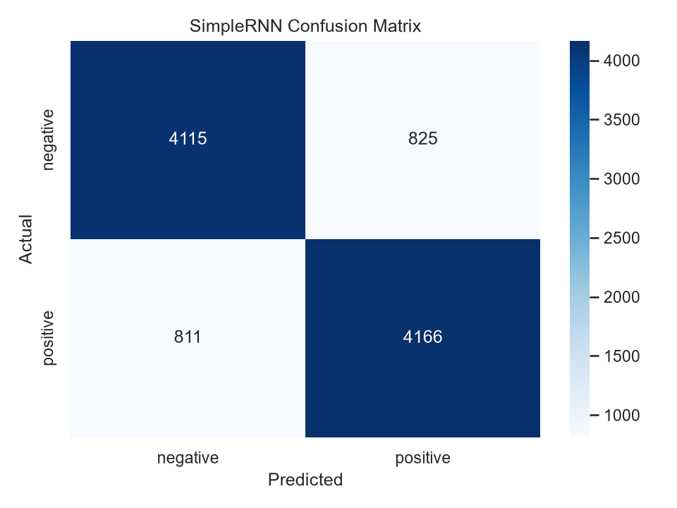

### 7. LSTM Training Curves

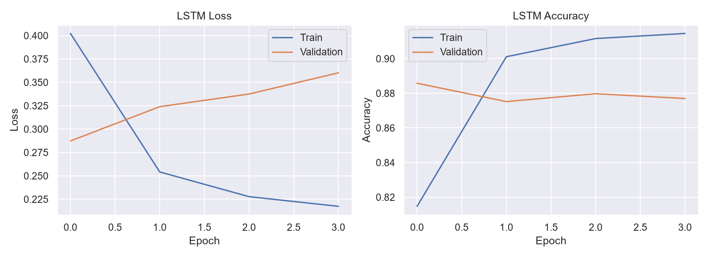

### 8. LSTM Confusion Matrix

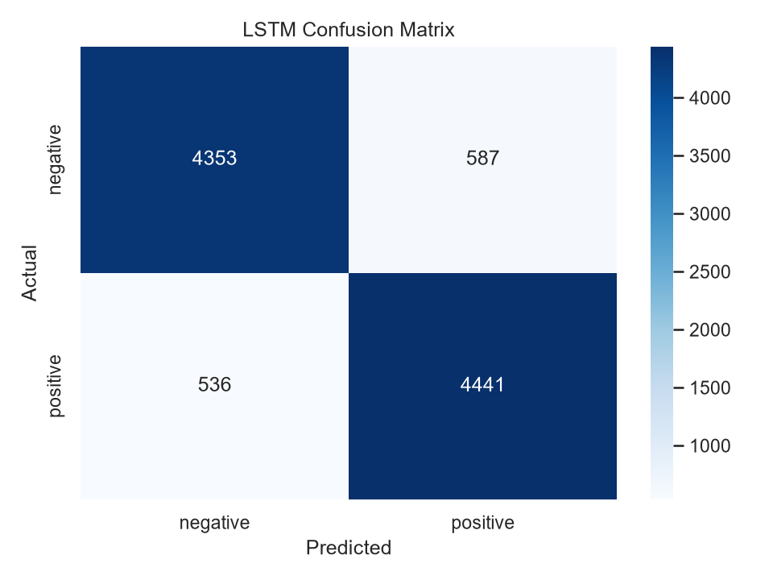

### 9. GRU Training Curves

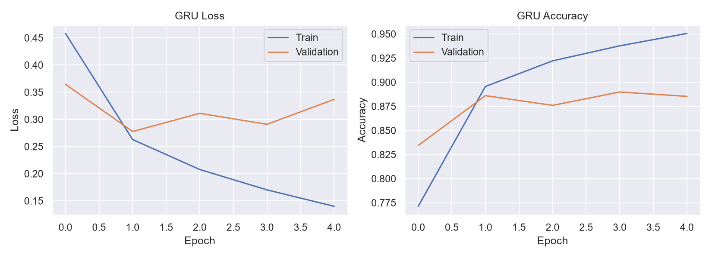

### 10. GRU Confusion Matrix


### 11. Accuracy by Review Length

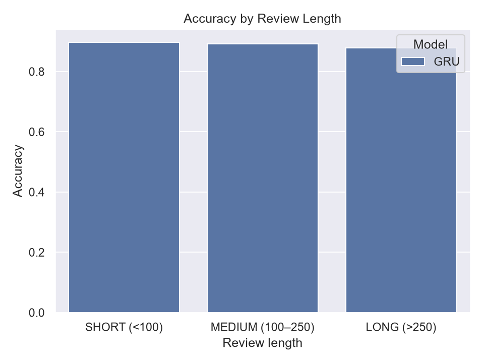

### 12. ROC Curves — Sentiment Models

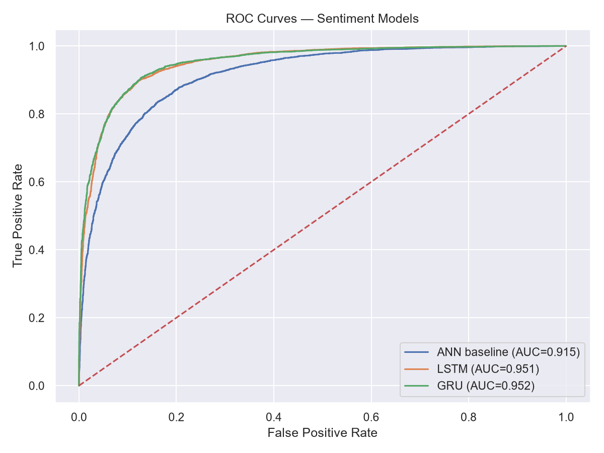

## Important Notes

- Run the notebook cells in order because later tasks use variables and models created earlier.
- Fit the tokenizer on training data only to reduce data leakage.
- Ensure the tokenizer vocabulary size matches the embedding layer's `input_dim`; token indices must be valid embedding-row indices.
- Set random seeds if you want more repeatable experiments.
- Training time depends on dataset size, hardware, and model settings.
- A single run does not prove that one architecture is always best.

## Technologies

`Python` · `TensorFlow/Keras` · `NumPy` · `Pandas` · `Matplotlib` · `Seaborn` · `Scikit-learn` · `Jupyter Notebook`


